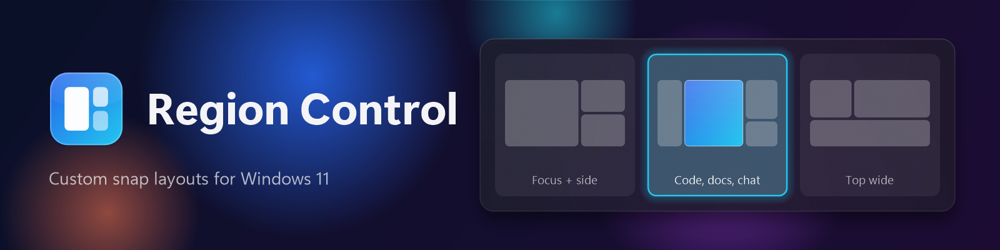
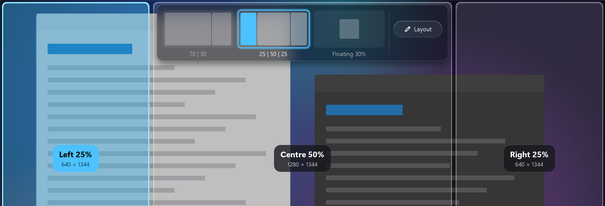
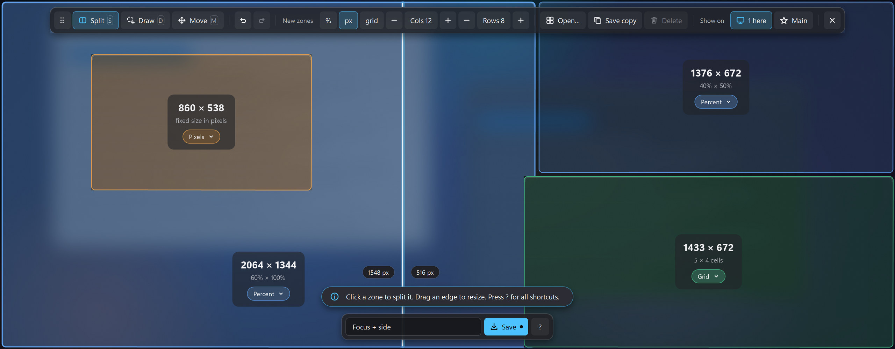

<p align="center">
  
</p>

# Snap Layouts

Custom snap layouts for Windows 11. Drag a window to the top edge of the screen and pick from your own layouts, not just even splits. Draw the layouts yourself.

> **Pre-release (v0.1.2).** Snap Layouts works on the author's PC, but it has had little testing elsewhere. The installer is not code-signed, so Windows SmartScreen will warn you. See [Known limits](#known-limits).

## Features

- **Your own layouts.** Zones of any size and position, including overlapping and floating boxes. Each zone uses free pixels, percent or a snap grid.
- **Top-edge picker.** Drag a window by its title bar to the top edge. A glass strip of layout thumbnails opens. Hover one to see its zones, then drop the window on a zone.
- **Layout editor.** Split and resize, draw zones with the mouse, or start from a saved layout. Drop a window on the **Layout** pill in the picker to open the editor at once.
- **Per monitor.** Each monitor has its own layouts. Layouts can be shared, and a saved set picks one layout per monitor for a given monitor setup.
- **Quiet tray app.** No console window. Optional start with Windows.
- **Keeps Win+Arrow.** Snap Layouts only replaces the drag-to-top snapping.
- **Restores size.** Drag a snapped window out of its zone and it returns to its earlier size.





## Install

Requires Windows 11 (64-bit). You do not need to install .NET.

1. Download **SnapLayouts-Setup-0.1.2.exe** from the [latest release](../../releases/latest).
2. Run it. If Windows SmartScreen says "Windows protected your PC", choose **More info**, then **Run anyway**. The installer is unsigned for now.
3. On the tasks page, choose how to deal with Windows' own snapping (see below).
4. Finish the wizard. Snap Layouts starts in the system tray. If you do not see its icon, click the **^** arrow next to the clock.

The installer installs for the current user by default. You can also install for all users. It upgrades an older version in place and keeps your layouts.

**Portable:** download **SnapLayouts-Portable-0.1.2.exe** and run it from any folder. It is the same program in one file.

To check a download, compare it with `SHA256SUMS.txt` from the release page:

```powershell
Get-FileHash .\SnapLayouts-Setup-0.1.2.exe -Algorithm SHA256
```

### Turn off Windows' own drag snapping

Windows has its own snap-on-drag. Snap Layouts needs it off, or the two fight over the drag. Choose one:

| Option | What it does | Win+Arrow |
| --- | --- | --- |
| **A. Let Snap Layouts do it** (installer task) | Sets two user settings: `DockMoving` to `0` and `EnableSnapBar` to `0`. The uninstaller restores the old values. | Keeps working |
| **B. Do it yourself** | Settings > System > Multitasking > turn **Snap windows** off. | Stops working |

If you use the portable exe, run `src/native-snap-off.ps1` from this repository for option A, and `src/native-snap-restore.ps1` to undo it.

## Use

1. Drag any window by its title bar to the top edge of a screen.
2. Pick a layout in the strip. Hover it to see its zones.
3. Drop the window on a zone. The window snaps to it.
4. If the layout has more zones, a window picker opens in each empty zone in turn (left to right, bottom to top). Pick a window to snap it there, or choose **Skip this zone**. **Esc** ends the sequence.
5. Press **Esc**, right-click, or drop outside every zone to cancel. Esc and right-click put the window back where the drag began.

**Side edges:** drag a window to the left or right edge of a screen to show the first layout in the strip. The zone on that edge lights up. Drop to snap the window there. An edge that borders another screen does not count.

To edit layouts, drop a window on the **Layout** pill, or right-click the tray icon and choose **Edit layouts**. In the editor, press **?** (or H or F1) for the shortcuts.

In the editor, choose **Open** and drag a layout card to change the order of the picker strip. The **Blank** card starts an empty screen: draw your own zones.

Your layouts are saved automatically. See [Files](#files).

### Files

- Layouts: `%APPDATA%\RegionControl\layouts.json` (with a `.bak` copy). The folder keeps its old name, so settings from earlier versions carry over.
- Log: `%APPDATA%\RegionControl\logs`
- Optional theme overrides: `%APPDATA%\RegionControl\theme.json`

## Known limits

- Windows running as administrator cannot be moved, unless Snap Layouts also runs as administrator.
- Apps with a minimum window size may not fit a small zone.
- Dragging a tab out of Chrome does not open the picker.
- The picker blur is a still copy of the screen behind it, not live acrylic.
- Multi-monitor and mixed-DPI support is written but has had little real-world testing.
- The installer and exe are not code-signed, so SmartScreen warns.

## Uninstall

Settings > Apps > Installed apps > Snap Layouts > Uninstall. The uninstaller asks whether to delete your layouts and logs. It restores the Windows snap settings if you chose option A.

## Build from source

You need the .NET 8 SDK and, for the installer, [Inno Setup 6](https://jrsoftware.org/isinfo.php).

```powershell
# Build and run in place
src\run.cmd

# Self-test
src\test.cmd

# Portable exe into dist\portable, then installer into dist\
powershell -NoProfile -ExecutionPolicy Bypass -File src\build-installer.ps1
```

## License

[MIT](LICENSE). Copyright (c) 2026 inNATE Tools.
